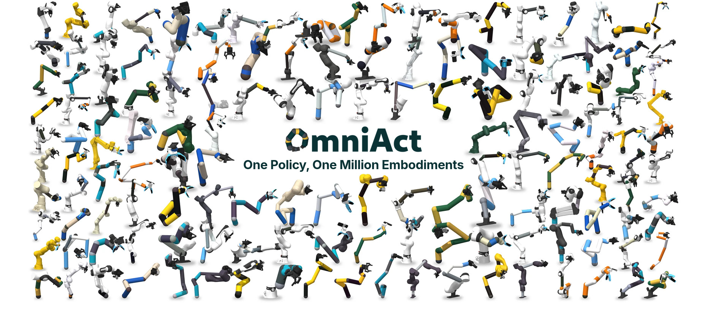
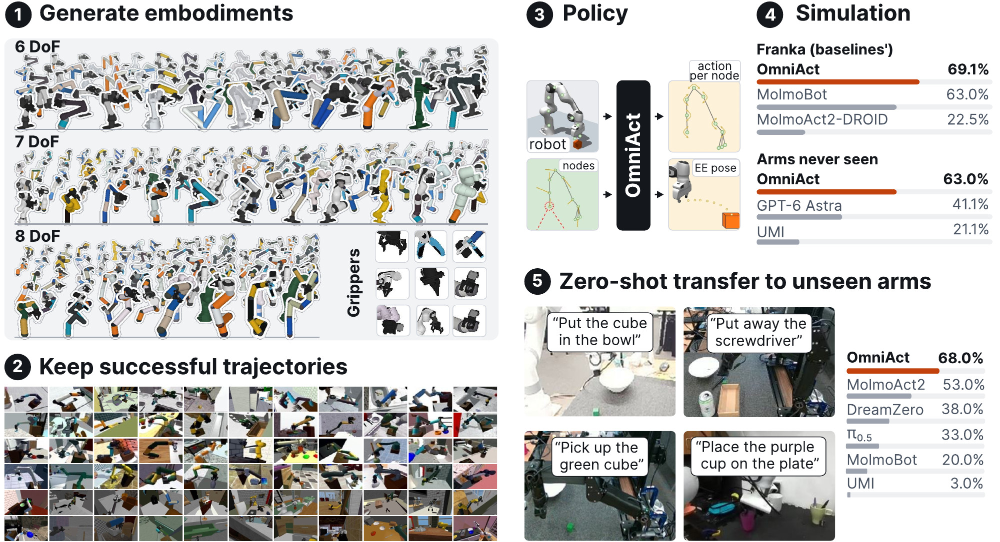

<p align="center">
  
</p>

<p align="center">
  Xiang Fan<sup>1*</sup> · Yuheng Wang<sup>1*</sup> · Jiayuan Yan<sup>1</sup> · Bohan Fang<sup>1</sup> · Wisdom Oluchi Ikezogwo<sup>1</sup> · Ainaz Eftekhar<sup>1</sup>
  <br>
  Max Argus<sup>3</sup> · Zhongzheng Ren<sup>1,2</sup> · Jiafei Duan<sup>4</sup> · Ranjay Krishna<sup>1</sup>
  <br>
  <sup>1</sup>University of Washington · <sup>2</sup>University of North Carolina at Chapel Hill
  <br>
  <sup>3</sup>Allen Institute for Artificial Intelligence · <sup>4</sup>National University of Singapore
  <br>
  <sup>*</sup>Equal contribution
</p>

<p align="center">
  <a href="https://arxiv.org/abs/2611.33158"><b>Paper</b></a> &nbsp;·&nbsp;
  <a href="https://omniact.github.io/"><b>Project page</b></a> &nbsp;·&nbsp;
  <a href="https://omniact.github.io/#real-world"><b>Videos</b></a> &nbsp;·&nbsp;
  <a href="#citation"><b>Citation</b></a>
</p>

<p align="center">
  OmniAct <b>zero-shot controls unseen robots</b> on a variety of tasks with surprisingly good robustness. It takes advantage of <b>robot-specific features</b> to maximize its task success.
</p>

## Overview

OmniAct is a cross-embodiment manipulation policy that conditions directly on each robot's kinematics in the scene. Each joint and fingertip of the robot becomes a node of a **scene-grounded kinematic graph**, placed in the 3D frame of every camera that observes it, and a flow-matching Transformer predicts a relative motion for every node. One network therefore controls arms with different numbers of joints and kinematic structures. To learn how a robot's body shapes its behavior, we procedurally generate **one million** robot embodiments, collect successful simulated trajectories for them, and train a single policy on the resulting data.

<p align="center">
  
  <br>
  <sub>(1) Generate diverse embodiments procedurally. (2) Keep their successful simulated trajectories. (3) Train a single policy, OmniAct. (4, 5) Evaluate it zero-shot in simulation and on real robots.</sub>
</p>

## Results

| Setting | OmniAct | Strongest baseline |
|---|:---:|:---:|
| **OmniAct-Bench** (sim): unseen robots in unseen scenes | **63.0%** | 57.9%&nbsp;(UMI,&nbsp;all&nbsp;views) |
| **MolmoSpaces** (sim): a Franka Panda, seen by every baseline but not OmniAct | **69.1%** | 63.0%&nbsp;(MolmoBot) |
| **Real OpenYAM**: arm and gripper zero-shot for OmniAct | **13/20** | 7/20&nbsp;(MolmoAct2) |
| **Real Franka Panda**: arm zero-shot for OmniAct | 14/20 | 15/20&nbsp;(DreamZero) |

## Release

This repository will host the code, checkpoints and data. I'm working on it.

- [ ] Policy code: training and inference
- [ ] Trained checkpoints
- [ ] Dataset generator

## Citation

```bibtex
@misc{fan2026omniactpolicymillionembodiments,
      title={OmniAct: One Policy, One Million Embodiments},
      author={Xiang Fan and Yuheng Wang and Jiayuan Yan and Bohan Fang and Wisdom Oluchi Ikezogwo and Ainaz Eftekhar and Max Argus and Zhongzheng Ren and Jiafei Duan and Ranjay Krishna},
      year={2026},
      eprint={2611.33158},
      archivePrefix={arXiv},
      primaryClass={cs.RO},
      url={https://arxiv.org/abs/2611.33158},
}
```
